# IARA HQ — Guia de testes do plano de UX

17/11/2026 (atualizado em 23/11/2026) · cópia do Claude Doc "IARA HQ — Guia de testes do plano de UX"

## 1. Como usar este guia

Faça primeiro a configuração da seção 2 (uns 20 minutos no iPhone). Sem ela, metade dos testes não tem dado nem canal. Depois siga as ondas em ordem: cada UX traz o que mudou, os casos de uso, o passo a passo do teste, o resultado esperado e os pontos de atenção.

- **Onde testar:** o hub em `iara-agents-hq.vercel.app`, de preferência aberto pelo ícone instalado no iPhone. Algumas coisas (voz do navegador, push) se comportam diferente no Safari solto e no app instalado.
- **Onde conferir:** SQL Editor do Supabase (projeto `wrtrhdrohabspbaxpbeu`), só com `select`. As consultas prontas estão na seção 8. Nada de editar dado à mão: se algo estiver errado, anote e me chame.
- **Custo:** os testes marcados com **IA** gastam alguns centavos de dólar. O total de todos os testes deste guia fica abaixo de US$ 0,50.
- **Chave da Anthropic:** a chave geral bateu o limite do Console até 01/12. As funções que já têm chave própria rodam (o briefing de 17/11 saiu). Se um teste de IA falhar com erro de limite ou 429, marque "Pendente: chave" e siga.
- **Desfazer:** quase tudo o que você registrar nos testes tem "Desfazer" por 10 minutos (UX-16). Use isso para limpar teste. A exceção é o peso: registre um valor real.

O acompanhamento fica na tabela da seção 8: marque o status de cada teste ali, e escreva um comentário no ponto exato do guia quando algo sair diferente do esperado.

## 2. Configuração inicial (depende de você)

Seis passos destravam todos os testes; os três primeiros são obrigatórios. Faça no iPhone, nesta ordem.

1. **Instalar o hub como app.** No Safari, abra `iara-agents-hq.vercel.app`, toque em **Share** → **Add to Home Screen**. Feche o Safari e abra sempre pelo ícone novo (o cérebro). Exige iOS 16.4 ou mais novo.
2. **Ativar as notificações.** Pelo ícone, vá em Perfil → "Ativar notificações" e toque em **Allow** quando o iPhone perguntar. Depois toque em "Enviar teste": o aviso deve chegar em segundos. Hoje nenhum aparelho está inscrito, então nenhum aviso chega (UX-04 e UX-20 dependem disso).
3. **Conferir os limites de avisos.** Em Perfil → Limites: máximo de avisos por dia = 3 e silêncio das 23:00 às 07:00 (sua decisão D3). Ajuste se quiser.
4. **Montar o Atalho "Falar com a IARA".** Em Perfil → "Falar com a IARA pela Siri", crie o token e copie na hora (ele aparece uma vez só). No app **Shortcuts**:
   1. Crie um atalho chamado **Falar com a IARA**.
   2. Adicione **Dictate Text**.
   3. Adicione **Get Contents of URL**: a URL do botão "Copiar" do Perfil, **Method** POST, **Headers** `Authorization` = `Bearer iar_…` (botão "Copiar") e `Content-Type` = `application/json`, **Request Body** JSON com `texto` = **Dictated Text** e `canal` = `atalho`.
   4. Adicione **Speak Text** com o resultado da ação anterior (**Contents of URL**).
   5. Teste: "Hey Siri, Falar com a IARA" → "li até a página 10" (desfaça depois se não for real).
5. **Dados que a IARA precisa para planejar.** Em `/aprender` → Livros: cadastre o livro que está lendo (páginas e página atual) e a meta de livros do ano. Em `/semana`: preencha expediente, lugares (com deslocamento) e compromissos pessoais fixos.
6. **Agenda (opcional).** Para a IARA enxergar sua agenda, cadastre o link iCal (Google ou iPhone) no secret `IARA_AGENDA_ICS_URLS` do Supabase: Edge Functions → Secrets. Vários links separados por vírgula. Sem ele, o plano da semana ignora sua agenda.

Ponto de atenção: o token da Siri só vale para a IARA. O token antigo do Atalho de peso continua só com o escopo `peso` e não serve para falar com a IARA (e vice-versa). Se perder o token, revogue e crie outro.

## 3. Onda 1: consertar o que já existe (UX-01 a UX-07)

A onda 1 não cria arquitetura nova: liga telas que só liam, dá memória aos alertas e prepara o briefing para ser ouvido. Só o UX-05 usa IA.

### UX-01 · Catálogo de intenções (PR #37)

**O que mudou:** a tabela `core.intencoes` lista tudo o que pode ser pedido à IARA, com a RPC que executa, o risco e se pede confirmação. Não tem tela: é a base da barra "Peça à IARA", da Siri e dos avisos.

**Casos de uso:** você não usa direto. Toda frase que a IARA entende vira uma linha deste catálogo.

**Como testar:**

1. Rode a consulta "Catálogo" da seção 8.
2. Confira que toda linha ativa tem `confirmacao` preenchida e que as de risco alto pedem "sim".

**Esperado:** 31 intenções ativas em 17/11, 7 delas de risco alto (começou com 7 e cada UX acrescentou as suas).

**Atenção:** se um pedido seu não for entendido pela IARA, a primeira pergunta é "existe intenção para isso?". Se não existir, é item novo, não defeito.

### UX-02 · Livros e leitura (PR #39)

**O que mudou:** bloco "Livros" em `/aprender` com o livro atual, a fila, "X de N no ano", páginas por dia necessárias e o campo "Li até a página…". A meta do ano mora no seu perfil. O briefing passa a citar meta e ritmo.

**Casos de uso:**

- "Quero ler 12 livros este ano": defina a meta e veja quantas páginas por dia faltam.
- Terminou a leitura da noite: registre a página e o progresso do livro e da meta anda sozinho.
- Montar a fila do que vem depois.

**Como testar:**

1. Em `/aprender` → Livros, toque em "Definir meta" e responda "Quantos livros quer ler neste ano?".
2. Cadastre o livro atual com total de páginas e status lendo.
3. Registre uma página maior que a atual (ex.: atual + 20).
4. Recarregue a tela. Rode a consulta "Últimas leituras" da seção 8.

**Esperado:** a página atual do livro muda, aparece 1 linha nova em `sabia.leituras`, "páginas/dia" é recalculado. No briefing do dia seguinte, a SabIA cita a meta.

**Atenção:**

- Registrar sem escolher livro grava no livro com status "lendo". Com dois livros em leitura, escolha o livro.
- Registrar uma página menor que a atual é aceito (correção). Use Desfazer se errar.
- Ao chegar na última página, o livro vira "lido" e conta na meta do ano.

### UX-03 · Metas do AIrton (PR #40)

**O que mudou:** seção "Metas" em `/financas` para criar e editar metas de dinheiro (imóvel, carro, reserva). Cada meta mostra "precisa de R$ X/mês; você guarda R$ Y", calculado com a poupança média real dos últimos 3 meses. O chat do AIrton ganhou a ferramenta `goals`.

**Casos de uso:**

- "Entrada do apartamento: R$ 160 mil até dez/2028": quanto preciso guardar por mês?
- Duas metas ao mesmo tempo (carro e imóvel): cabem na poupança?
- Perguntar ao AIrton "como estão minhas metas?".

**Como testar:**

1. Em `/financas` → Metas, crie uma meta com valor, valor atual e prazo. Confirme quando a tela pedir.
2. Confira a conta: aporte = (alvo − atual) ÷ meses até o prazo. Ex.: R$ 100.000 em 24 meses = R$ 4.166,67/mês.
3. Crie uma segunda meta grande o bastante para a soma passar da sua poupança.
4. **IA:** no chat do AIrton (app antigo), pergunte "como estão minhas metas?".

**Esperado:** passo 3 marca as duas metas em conflito (e aparece em `/planos`, UX-12). Passo 4 responde com os números da tela e grava 1 linha em `airton.ai_usage`.

**Atenção:**

- A poupança usa os lançamentos reais. Se há muito lançamento sem categoria (UX-07), o "você guarda R$ Y" fica distorcido: revise antes de confiar.
- A prioridade entre metas nasce vazia (sua decisão D2). Conflito vai para o painel, nunca é resolvido sozinho.
- Para testar e apagar: use "Arquivar", não há exclusão.

### UX-04 · Avisos no iPhone (PRs #35 e #38)

**O que mudou:** o hub virou app instalável (PWA) com notificações. Os avisos que o AIrton já gerava (diário, semanal, plano da semana, custo) finalmente têm para onde ir.

**Casos de uso:** receber "Plano da semana pronto" no domingo; tocar no aviso e cair direto na tela certa.

**Como testar:**

1. Faça os passos 1 e 2 da seção 2.
2. Toque em "Enviar teste" e depois toque no aviso que chegou.
3. Rode a consulta "Push" da seção 8.

**Esperado:** 1 linha em `airton.push_subscriptions`; o teste aparece em `notify_log` com `sent = 1`; o toque abre o hub na rota do aviso.

**Atenção:**

- Só funciona aberto pelo ícone da Tela de Início. No Safari comum, o iPhone não oferece push.
- Se apagar o app da Tela de Início, a inscrição morre: reinstale e ative de novo.
- Focus / Do Not Disturb do iPhone segura o aviso; não é defeito do hub.

### UX-05 · Briefing falável (PR #41) · IA

**O que mudou:** o briefing das 07:00 ganhou uma versão para ouvir (até 70 palavras, sem markdown), gerada na mesma chamada. Botão "Ouvir"/"Parar" no cartão do briefing em `/hoje`, com a voz do próprio iPhone.

**Casos de uso:** ouvir o dia enquanto se arruma; parar no meio.

**Como testar:**

1. Em `/hoje`, no cartão "Briefing do dia · IARA", toque em "Ouvir".
2. Toque de novo para parar.
3. Rode a consulta "Briefing" da seção 8.

**Esperado:** a fala tem 1 compromisso, 1 prioridade, 1 número e no máximo 1 pergunta; `lido_em` preenchido depois do toque; custo do dia ≤ US$ 0,015 (17/11 custou US$ 0,0121).

**Atenção:**

- O som sai pelo navegador: com o iPhone no silencioso, a fala pode não tocar. Teste com o som ligado.
- A voz depende das vozes em português instaladas no iPhone (Settings → Accessibility → Spoken Content → Voices → Portuguese (Brazil); baixe uma voz de lá).
- Briefings anteriores a 17/11 não têm fala: o botão some neles.

### UX-06 · Alertas da ClaudIA com memória (PR #42)

**O que mudou:** os alertas de saúde (sem pesagem, treino atrasado etc.) eram recalculados a cada abertura e nunca apagavam. Agora um job diário às 06:50 publica cada alerta uma vez por semana, com Feito, Amanhã e Ignorar, em `/hoje` e `/saude`.

**Casos de uso:** "sem pesagem há 7 dias": pese, toque em Feito e o badge apaga; "não é hora": Ignorar e ele não volta até a semana seguinte.

**Como testar (a partir de 18/11, depois das 06:50):**

1. Abra `/hoje` e `/saude` e anote os alertas.
2. Toque em Ignorar em um, Amanhã em outro.
3. Recarregue. No dia seguinte, abra de novo.

**Esperado:** o ignorado some e não volta na mesma semana; o adiado volta no dia seguinte; o badge da ClaudIA conta só o que está aberto. Nenhum alerta duplicado.

**Atenção:** o alerta vale a semana inteira. "Sem pesagem" não some sozinho quando você pesa: toque em Feito, ou ele só sai na semana seguinte. A primeira execução é 18/11 às 09:50 UTC.

### UX-07 · Revisão de lançamentos (PR #43)

**O que mudou:** o aviso "N lançamentos precisam de você" em `/hoje` agora leva a uma lista "Para revisar" em `/financas`, com a categoria sugerida. Um toque aceita, "Trocar" escolhe outra categoria.

**Casos de uso:** limpar a fila de lançamentos do Open Finance em 2 minutos no fim do dia.

**Como testar:**

1. Anote o número do aviso em `/hoje` e toque nele.
2. Em "Para revisar", aceite 1 sugestão e troque a categoria de outro.
3. Volte a `/hoje`.

**Esperado:** o número de `/hoje` bate com o tamanho da lista e cai 1 a cada ação.

**Atenção:** aceitar grava a categoria de vez (não há desfazer nesta tela). Na dúvida, use "Trocar". Lançamentos sem sugestão pedem a escolha manual.

## 4. Onda 2: plano de vida e porta única (UX-08 a UX-17)

A onda 2 cria o plano de vida (longo → médio → curto prazo, com dono e progresso medido) e a barra "Peça à IARA". Teste nesta ordem: crie um plano (UX-11), veja na tela (UX-10), espere uma noite (UX-09, UX-12, UX-13) e depois use a barra (UX-15, UX-16).

### UX-08 · Planos e metas por horizonte (PR #44)

**O que mudou:** a base de dados do plano de vida. Cada plano (imóvel, carro, carreira, hábito…) tem metas em três horizontes, cada meta com um agente dono (AIrton, SabIA, ClaudIA ou IARA), medida, prazo e histórico de eventos. Só você vê os seus.

**Casos de uso:** "comprar um apartamento até 2030" vira: longo = entrada juntada; médio = reserva de R$ X até 2027; curto = aporte deste mês. Carreira e hobbies ficam com a IARA como dona (sua decisão D1).

**Como testar:** pelos UX-10 e UX-11. Na barra da IARA, "como estão meus planos?" lista os planos.

**Atenção:**

- Salvar um plano com o mesmo título não duplica: atualiza o existente.
- Mudar uma meta de plano pede "sim" (risco alto). Criar ou ajustar o plano em si também.

### UX-09 · Progresso medido sozinho (PR #45)

**O que mudou:** todo dia às 06:00 (SP) um job sem IA mede o progresso de cada meta na fonte: saldo da meta no AIrton, livros e páginas na SabIA, peso e sessões na ClaudIA, marcos da IARA. Compara com o ritmo esperado (linear até o prazo, tolerância de 10%) e diz se está no ritmo, adiantado ou atrasado.

**Casos de uso:** meta "12 livros em 2026" anda quando você registra a leitura; meta de peso anda com a pesagem; ninguém digita progresso.

**Como testar:**

1. Tenha um plano ativo com uma meta ligada a livros (ex.: plano de leitura criado pelo UX-11).
2. Registre uma leitura que termine um livro.
3. No dia seguinte, depois das 06:00, abra `/planos`.

**Esperado:** o progresso da meta subiu (1 livro de 4 = 25%) e o ritmo foi recalculado. Rodar duas vezes no mesmo dia não cria evento repetido.

**Atenção:**

- O progresso só muda uma vez por dia. Registrou agora, veja amanhã.
- Meta sem fonte de dado aparece como "sem dados", não como erro. Se muitas metas ficarem assim, me chame: falta um adaptador.
- Ritmo linear é simplificação: uma meta de poupança com bônus em dezembro parece atrasada até lá.

### UX-10 · Tela /planos (PR #46)

**O que mudou:** rota `/planos` (link "Planos →" em `/hoje`, ao lado de "Semana →"). Um cartão por plano com os três horizontes, o dono de cada meta na cor do app, progresso, ritmo, prazo e o próximo passo da semana. Em `/hoje`, só as metas atrasadas.

**Casos de uso:** ver de uma vez se a vida está no rumo; em `/hoje`, ser lembrado só do que saiu do ritmo.

**Como testar:**

1. Sem plano: abra `/planos` e confira o estado vazio ("Nenhum plano ainda").
2. Depois do UX-11: confira o cartão, as cores dos donos (AIrton azul, SabIA vermelho, ClaudIA verde, IARA lilás) e o prazo.
3. Em `/hoje`: uma meta no ritmo não aparece; atrasada aparece.

**Atenção:** "Próximo passo da semana" só aparece depois que o plano da semana (domingo) ligar itens às metas (UX-14). Antes disso a linha fica vazia: é esperado.

### UX-11 · Plano nasce de uma frase (PR #48) · IA

**O que mudou:** em `/planos` → "Novo plano", você escreve o objetivo em uma frase. A IARA pergunta o que faltar (valor e prazo, até 3 rodadas, decisão D2), consulta os outros agentes e propõe metas para os três horizontes. Você edita o rascunho e confirma ou descarta.

**Casos de uso:**

- "Quero comprar um apartamento de 800 mil até 2030" (frase completa: deve ir direto ao rascunho).
- "Quero trocar de carro" (incompleta: deve perguntar valor e prazo).
- "Quero tocar violão em um sarau no fim do ano" (dona IARA, apoio da SabIA).

**Como testar:**

1. Em `/planos`, toque em "Novo plano" e use a frase incompleta. Responda as perguntas (botões ou "Ou escreva a resposta").
2. Espere 10 a 20 s. Confira o rascunho: pelo menos 1 meta por horizonte, todas com dono e "Primeiro passo".
3. Edite uma meta e toque em Confirmar.
4. Repita com outra frase e toque em Descartar.
5. Rode as consultas "Custo de IA" e "Metas do AIrton" da seção 8.

**Esperado:** plano confirmado fica ativo; se tiver meta de dinheiro, nasce uma meta em `/financas` ligada a ele; o descartado some. Custo por plano entre US$ 0,04 e 0,08, teto US$ 0,10. Rascunho não aparece em `/hoje`.

**Atenção:**

- Confirmar duas vezes não cria duas metas no AIrton. Se aparecer duplicada, me chame.
- Se a IARA perguntar a mesma coisa duas vezes, anote a frase: houve um defeito parecido na verificação, já corrigido.
- Esta chamada usa IA nova: pode falhar pelo limite da chave até 01/12.

### UX-12 · Conflitos de dinheiro e tempo (PR #47)

**O que mudou:** a IARA soma o que as metas ativas pedem e compara com o que você tem: poupança prevista por mês (dinheiro) e minutos livres por semana (10.080 − sono − expediente − rotina). Sem IA.

**Casos de uso:** carro e imóvel juntos pedem R$ 6 mil/mês e você guarda R$ 4 mil; violão + academia + leitura pedem mais horas do que sobram.

**Como testar:**

1. Crie duas metas de dinheiro cuja soma de aportes passe da sua poupança (UX-03 ou UX-11).
2. No dia seguinte, confira `/planos`.
3. Pause ou conclua uma delas e veja o conflito sumir.

**Esperado:** o conflito vira uma decisão (UX-13), nunca uma escolha automática.

**Atenção:** o conflito de tempo só é confiável com expediente e rotina preenchidos (seção 2, passo 5). Sem eles, a conta supõe tempo livre demais.

### UX-13 · Painel de decisão (PR #49) · IA

**O que mudou:** cada conflito abre uma decisão, com 2 a 4 opções. Ao abrir, cada agente com interesse dá sua posição com confiança de 0 a 10, e a IARA sintetiza: concordam, divergem, recomendação. Cartão "Decisão" em `/planos` e aviso em `/hoje`.

**Casos de uso:** "carro agora e adiar o imóvel 1 ano, ou manter o imóvel e adiar o carro?"; o AIrton fala de fôlego financeiro, a IARA do impacto nos outros planos.

**Como testar:**

1. Com o conflito do UX-12 aberto, abra o cartão "Decisão" e espere as posições.
2. Leia "Síntese · IARA". Escolha uma opção e confirme com "Sim".
3. Confira as metas afetadas e tente decidir de novo.

**Esperado:** a opção escolhida altera prazo ou valor das metas; a decisão fecha; a segunda tentativa não reaplica. Custo do painel até US$ 0,03, no máximo 10 por mês.

**Atenção:**

- A recomendação é só destacada. Nada é escolhido sem o seu "Sim" (D2 e D3).
- Defeito conhecido: decidir uma decisão já tomada mostra só "Erro 409". O dado está certo, só a mensagem é ruim.
- Um gatilho decidido não reabre por 30 dias. Se o conflito sumir sozinho, a decisão expira.

### UX-14 · Replanejar quando algo muda (PR #50) · IA

**O que mudou:** quatro peças.

- Gatilhos sem IA: meta atrasada em 2 checagens seguidas, renda prevista mudou mais de 10%, compromisso fixo novo acima de 120 min/semana, prazo alterado, 14 dias sem registro.
- O plano da semana (domingo) passa a trazer itens ligados às metas, com a etiqueta do plano em `/semana`.
- Refazer o rascunho da semana preserva o que você moveu ou editou.
- No 1º domingo de cada mês, a IARA revisa todos os planos e propõe até 5 ajustes em "Propostas da IARA" (`/planos`); a cada trimestre inclui o longo prazo.

**Casos de uso:** perdeu renda → a IARA propõe esticar o prazo do carro; ficou 14 dias sem ler → gatilho e aviso; mexeu na terça da semana e pediu para refazer → sua mudança fica.

**Como testar:**

1. Domingo 22/11, depois do plano da semana: em `/semana`, confira itens com a etiqueta do plano.
2. Mova um item de dia, peça para refazer o rascunho e confira que o item movido ficou onde você pôs.
3. Domingo 06/12, depois das 10:00 (SP): em `/planos` → Propostas da IARA, aceite uma (com "Sim") e recuse outra.

**Esperado:** até 5 propostas, cada uma com motivo; aceitar muda a meta; custo da revisão até US$ 0,08.

**Atenção:**

- Plano da semana já confirmado nunca é alterado pelo "refazer".
- Gatilho repetido não gera evento nem aviso duplicado.

### UX-15 · Peça à IARA (PR #51) · IA

**O que mudou:** barra "Peça à IARA…" em `/hoje`. Você escreve (ou dita pelo microfone do teclado) e a IARA entende a intenção, executa com o seu próprio login e responde em um cartão. Pergunta de dinheiro vai para o AIrton. Fora do catálogo, ela devolve uma pergunta fechada, não erro. Lembra 30 minutos de conversa.

**Casos de uso e frases de teste:**

| Frase | O que deve acontecer | Confirmação |
| --- | --- | --- |
| Li até a página 150 | Registra leitura no livro atual, mostra Desfazer | Nenhuma |
| Registra 82,4 quilos | Registra peso (sem Desfazer) | Nenhuma |
| Pratiquei violão 20 minutos | Registra prática (UX-17), com Desfazer | Nenhuma |
| Terminei a leitura de hoje | Marca o item da trilha da SabIA, com Desfazer | Nenhuma |
| Quanto posso gastar hoje? | Número do plano do mês, via AIrton | Nenhuma |
| Como estão meus planos? | Resumo dos planos e ritmos | Nenhuma |
| Marca dentista quinta às 15h | Executa e repete o que entendeu (dia e hora) | Repete |
| Adiciona o livro Sapiens na fila | Executa e repete o título | Repete |
| Confirma a semana | Pergunta e só confirma com "sim" | Sim |
| Muda o prazo da meta do carro para 2028 | Pergunta e só muda com "sim" | Sim |
| Qual a capital da França? | Diz que não é com ela e oferece opções | — |

Risco médio ("Repete") executa na hora e a resposta repete o que foi feito: confira se a IARA entendeu certo e corrija se não.

**Esperado:** escrita em até 4 s, pergunta com dados em até 8 s. Custo médio de um comando de escrita até US$ 0,001.

**Atenção:**

- Ela só usa números que você disse e só escolhe itens que são seus. Se ela "inventar" um número ou executar algo que você não pediu, é defeito grave: anote a frase exata.
- "O segundo", "esse" e "sim" funcionam por 30 minutos depois da última conversa.
- Defeito conhecido: "marca a trilha como feita" pode listar itens da trilha de hobby como opções.

### UX-16 · Confirmação por "sim" e Desfazer (PR #52)

**O que mudou:** ação de risco alto (dinheiro, treino, plano, meta, confirmar a semana) fica pendente até você dizer "sim", por até 10 minutos. Anotações (leitura, prática, feito, adiar) executam na hora, com Desfazer por 10 minutos. Confirmar a semana em `/semana` deixou o `confirm()` do navegador e ganhou cartão com Desfazer.

**Casos de uso:** ditou a página errada → "desfaz"; pediu algo grande por engano → "não".

**Como testar:**

1. Na barra: "li até a página X" (atual + 30), depois "desfaz". Confira em `/aprender` que a página voltou.
2. Peça uma ação de risco alto e responda "não". Nada muda.
3. Peça de novo, espere 11 minutos e diga "sim". Nada deve executar (expirou).
4. Em `/semana`, confirme a semana e use Desfazer logo em seguida.

**Esperado:** consulta "Ações pendentes" da seção 8 mostra os estados: confirmada, executada, cancelada, expirada, desfeita.

**Atenção:**

- Peso não tem Desfazer (não há como anular com segurança). Registre o valor certo de novo.
- Desconfirmar a semana só funciona se nenhum item da semana já foi marcado como feito.
- Desfazer nunca apaga linha: marca como desfeita. O histórico fica.

### UX-17 · Prática e habilidades (PR #53) · IA

**O que mudou:** bloco "Prática" em `/aprender` para cadastrar habilidades (instrumento, idioma, habilidade de carreira) com minutos por semana alvo, e registrar prática. No recap de domingo, a SabIA gera um plano de prática da semana por habilidade ativa (trilha hobby).

**Casos de uso:** "violão, iniciante, 60 min/semana"; "pratiquei violão 20 minutos" pela barra ou pela Siri; ver os minutos da semana na meta do plano.

**Como testar:**

1. Em `/aprender` → Prática, cadastre uma habilidade com alvo semanal.
2. Registre 20 minutos pela tela e 20 pela barra da IARA.
3. Domingo 22/11, depois do recap: confira a trilha hobby em `/aprender`.
4. Se houver meta de plano ligada à habilidade, no dia seguinte veja 40 de 60 min = 67%.

**Esperado:** cada registro vira uma linha; a trilha hobby sai uma vez só por semana; custo até US$ 0,002 por semana.

**Atenção:** a trilha hobby só é gerada para habilidade ativa. Sem habilidade cadastrada até domingo, nada sai, e isso é esperado.

## 5. Onda 3: voz (UX-18 a UX-22)

A onda 3 troca o teclado pela voz sobre a mesma porta da IARA: respostas curtas para ouvir, a Siri como canal, avisos que perguntam e a revisão da semana falada. Tudo depende da seção 2 (notificações e Atalho).

### UX-18 · Contrato de fala (PR #54) · IA

**O que mudou:** toda resposta da IARA (barra, Siri, planos) e do AIrton no canal de voz segue a mesma regra: até 2 frases e 40 palavras na voz, sem markdown nem lista, números em reais arredondados (erro de até 5%) e a pergunta final sempre preservada. O tempo de cada resposta fica gravado.

**Casos de uso:** ouvir "Você pode gastar cerca de 180 reais hoje" em vez de uma tabela; resposta que termina em pergunta ("Quer que eu adie?") nunca é cortada antes dela.

**Como testar:**

1. Pela Siri: "quanto posso gastar hoje?". Compare com o valor de `/financas`.
2. Pela Siri: "como estão meus planos?". Conte as frases.
3. Peça algo ambíguo e confira que a pergunta final chega inteira.
4. Rode a consulta "Latência" da seção 8.

**Esperado:** nenhuma resposta com asterisco, cerquilha ou lista falada; número dentro de 5% do real; mediana até 4 s para registrar e até 8 s para pergunta com dados.

**Atenção:**

- No chat do AIrton por texto nada mudou: o contrato vale só para voz e Atalho.
- A bateria automática de 20 frases (`bateria.ts`) ainda não rodou em produção: precisa do seu login (custa cerca de US$ 0,25). Posso rodar quando você pedir.

### UX-19 · IARA pela Siri (PR #55)

**O que mudou:** o Atalho "Falar com a IARA" manda o que você ditou para a IARA com um token só dela (`iar_…`) e fala a resposta. A IARA executa como você, com as mesmas regras de "sim" e Desfazer. Limite de 10 comandos por minuto.

**Casos de uso:** no carro, "Hey Siri, Falar com a IARA" → "li até a página 200"; na balança, "registra 82,4 quilos"; perguntar o saldo do dia sem abrir nada.

**Como testar:**

1. Monte o Atalho (seção 2, passo 4).
2. "Registra \[seu peso real\] quilos". Confira em `/saude`.
3. "Confirma a semana": a IARA pergunta. Rode o Atalho de novo e diga "sim".
4. "Desfaz" logo depois de registrar uma leitura.
5. "Quero criar um plano para trocar de carro": deve responder que isso é pelo app por enquanto.
6. Em Perfil, revogue o token e rode o Atalho. Depois crie outro e atualize o Atalho.

**Esperado:** passos 2 a 4 funcionam só por voz; passo 6 falha (o Atalho mostra erro 401) e volta a funcionar com o token novo.

**Atenção:**

- O "sim" só vale por 10 minutos e precisa de uma nova execução do Atalho.
- O token dá acesso a tudo o que a barra faz. Não compartilhe o Atalho exportado com o token dentro.
- Mais de 10 comandos em 1 minuto devolve erro 429: espere um minuto.
- Criar plano, painel de decisão e revisão ainda são só pelo app.

### UX-20 · Avisos proativos (PR #56)

**O que mudou:** os agentes agora chamam você, com limite. Uma fila de avisos recebe gatilhos de plano, decisões, propostas, contas vencendo e alertas da ClaudIA. O envio respeita o máximo por dia (3) e o silêncio (23h–7h), contando também os pushes antigos do AIrton. Prioridade: gatilho de plano > decisão > proposta > conta vencendo > hábito. Tocar no aviso abre `/hoje` com a pergunta e respostas de uma palavra.

**Casos de uso:** "Meta do carro atrasou 2 semanas. Rever o prazo?" → Sim/Depois; "Conta de luz vence amanhã"; "Sem pesagem esta semana" → Feito.

**Como testar:**

1. Com as notificações ativas (seção 2), espere 2 ou 3 dias de uso normal.
2. Toque em um aviso e responda pela tela que abrir.
3. Em Perfil → Limites, ponha máximo 1 por dia por um dia e confira.
4. Rode a consulta "Avisos" da seção 8.

**Esperado:** nunca mais que o máximo por dia; nada entre 23h e 7h (o que ficar para trás sai a partir das 7h ou no dia seguinte); responder executa a ação; resposta de risco alto ainda pede "sim".

**Atenção:**

- Sem notificações ativadas no iPhone, a fila enche e nada chega. É o bloqueio número 1 hoje.
- "Essa pergunta não vale mais" aparece quando o assunto já foi resolvido por outro caminho. É esperado.
- Se os avisos parecerem demais ou de menos, ajuste o limite antes de concluir que está errado.

### UX-21 · Voz em tempo real (pulado)

**Por quê:** exige a chave de um provedor de voz em tempo real (serviço pago novo) e, pela sua decisão D4, o protótipo de 1 dia com dois provedores só vem depois de a Siri (UX-19) estar em uso.

**O que destrava:** usar o Atalho por 1 ou 2 semanas; depois me pedir o protótipo; escolher o provedor; cadastrar a chave no Supabase. Teto combinado: US$ 5/mês.

### UX-22 · Revisar a semana falando (PR #57) · IA

**O que mudou:** no domingo às 18:00 (SP), o plano da semana passa a vir com uma fala (até 60 palavras) e até 3 decisões fechadas, na mesma chamada. Em `/semana`, "Revisar falando" lê a fala e faz uma pergunta por vez; no fim, "Confirma a semana?" pede "sim". As propostas mensais (UX-14) também têm fala.

**Casos de uso:** domingo à noite, fechar a semana em 3 minutos respondendo "mantém na quarta", "a primeira opção", "sim", sem editar item por item.

**Como testar (domingo 22/11, depois das 18:00):**

1. Em `/semana`, toque em "Revisar falando".
2. Responda cada decisão (Sim/Não ou a opção).
3. Em "Confirma a semana?", toque em "Sim, revisar e confirmar". Teste o Desfazer e confirme de novo.
4. Cronometre do primeiro toque até a confirmação.

**Esperado:** fala até 60 palavras; no máximo 3 perguntas; a semana fica confirmada sem você editar item; tudo em até 3 minutos; custo extra até US$ 0,005 por semana.

**Atenção:**

- Sem voz no navegador, aparece "Sem voz neste navegador: segue só em texto" e o fluxo continua por toque.
- Responder uma decisão nunca mexe em plano já confirmado.
- Se a IARA não tiver decisão a fazer, a revisão vai direto para a confirmação. Não é defeito.

## 6. Calendário de execuções automáticas

Sete execuções automáticas ainda não rodaram nenhuma vez em produção; a primeira é hoje, 18/11, às 06:00. Horários em São Paulo. Na data, rode a consulta "Crons" da seção 8 e confira o item da última coluna.

| Quando (SP) | O que roda | UX | O que conferir |
| --- | --- | --- | --- |
| 18/11 06:00 | Progresso dos planos, gatilhos e decisões (sem IA) | 09, 12, 13, 14, 20 | Job com status ok. Sem plano criado (hoje há 0), não há o que medir: rode de novo no dia seguinte ao primeiro plano |
| 18/11 06:50 | Alertas da ClaudIA (sem IA) | 06, 20 | Alertas em `/hoje` e `/saude` com Feito/Amanhã/Ignorar; nenhum duplicado no dia 19 |
| 18/11 07:00 | Briefing da manhã com fala | 05 | "Ouvir" funciona; fala até 70 palavras, sem `*` nem `#`; custo até US$ 0,015 |
| Dom 22/11 06:30 | Trilha da SabIA com recap e trilha hobby | 17 | Trilha hobby em `/aprender` se houver habilidade ativa cadastrada até sábado; custo até US$ 0,002 |
| Dom 22/11 18:00 | Plano da semana com fala e até 3 decisões | 14, 22 | "Revisar falando" em `/semana`; itens com etiqueta do plano; custo extra até US$ 0,005 |
| 01/12 | Limite da chave geral da Anthropic zera | todos com IA | Refazer os testes marcados "Pendente: chave" |
| Dom 06/12 10:00 | Revisão mensal dos planos | 14, 22 | Até 5 propostas com fala em `/planos`; custo até US$ 0,08 |

Os avisos (UX-20) não têm data: saem no ciclo do AIrton assim que houver aparelho inscrito e algo na fila. Hoje há 0 aparelhos e 0 avisos na fila.

## 7. Pontos de atenção e problemas conhecidos

Quatro defeitos pequenos já são conhecidos e não precisam ser reportados; o resto, sim.

**Problemas conhecidos (não reporte):**

| Onde | O que acontece | Impacto |
| --- | --- | --- |
| Painel de decisão (UX-13) | Decidir algo já decidido mostra só "Erro 409" | Só a mensagem; o dado está certo |
| Barra da IARA (UX-15) | "Marca a trilha como feita" pode oferecer itens da trilha hobby como opção | Escolha o item certo na pergunta |
| Peso (UX-16, UX-19) | Não tem Desfazer | Registre o valor certo de novo |
| Alertas da ClaudIA (UX-06) | O alerta vale a semana; só some com Feito ou Ignorar | Toque em Feito depois de resolver |

**Pontos de atenção gerais:**

- **Chave da Anthropic até 01/12.** Teste de IA que falhar com limite ou 429 vira "Pendente: chave", não defeito.
- **Gemini.** As chaves atuais recebem 403 na busca do Google; o sistema cai para o Claude sozinho. Não afeta nenhum teste deste guia, só encarece um pouco as buscas da SabIA e do AIrton.
- **Dados vazios dão resultado vazio.** Sem plano, livro, habilidade, expediente ou agenda, várias telas mostram estado vazio. Confira a seção 2 antes de concluir que algo quebrou.
- **Uma vez por dia.** Progresso, ritmo, conflitos, decisões e alertas são calculados de madrugada (06:00 e 06:50). O que você faz hoje aparece amanhã nesses blocos.
- **Nada se apaga.** Desfazer, ignorar, arquivar e descartar marcam o registro; o histórico fica. Dado de teste pode ficar, desde que esteja desfeito ou arquivado.
- **Não edite dado pelo Supabase.** Se algo estiver errado no banco, me chame: produção só muda por PR (regra do projeto).
- **Custo.** Teto de US$ 10 por mês por app. Em 17/11 o HQ estava em US$ 0,76 no mês. Se a consulta "Custo de IA" mostrar uma funcionalidade acima do estimado neste guia, me avise.
- **Fora do plano de UX, ainda pendente:** o bucket `airton-deploy` está público com 8 arquivos antigos e espera você autorizar apagar.

**Como reportar um problema:**

1. Comente no ponto exato deste guia (selecione o texto do teste e comente).
2. Diga: o que fez, o que esperava, o que aconteceu, hora aproximada e canal (hub, barra da IARA ou Siri).
3. Para a IARA, copie a frase exata que você disse ou escreveu.
4. Um print ajuda. Eu confiro os registros pelo lado do banco (só leitura) e abro o PR da correção.

## 8. Consultas de conferência e acompanhamento

Todas as consultas são só leitura e foram testadas em 18/11: copie para o SQL Editor do Supabase (projeto `wrtrhdrohabspbaxpbeu`) e rode. Depois marque o status na tabela do fim.

**Catálogo** (UX-01)

```sql
select slug, agent, risco, confirmacao, desfazer_rpc is not null as tem_desfazer
  from core.intencoes where ativo order by risco desc, slug;
```

**Últimas leituras** (UX-02, UX-16)

```sql
select l.data, b.titulo, l.pagina_final, b.pagina_atual, b.paginas, l.minutos, l.desfeita
  from sabia.leituras l join sabia.livros b on b.id = l.livro_id
 order by l.id desc limit 10;
```

**Metas do AIrton** (UX-03, UX-11)

```sql
select name, kind, target_amount, current_amount, target_date, status, priority
  from airton.goals order by created_at desc;
```

**Push** (UX-04)

```sql
select (select count(*) from airton.push_subscriptions) as aparelhos, kind, created_at, sent, failed
  from airton.notify_log order by created_at desc limit 10;
```

**Briefing** (UX-05)

```sql
select data, lido_em, array_length(regexp_split_to_array(trim(fala), '\s+'), 1) as palavras,
       fala ~ '[*#]' as tem_markdown, fala
  from core.briefings where fala is not null order by data desc limit 5;
```

**Alertas da ClaudIA** (UX-06)

```sql
select origem, titulo, status, data, chave_origem
  from core.itens where origem = 'claudia' and tipo = 'alerta'
 order by created_at desc limit 20;
```

**Planos e metas** (UX-08 a UX-11)

```sql
select p.titulo as plano, p.status, m.horizonte, m.dono, m.titulo as meta, m.progresso, m.ritmo, m.prazo
  from core.planos p join core.plano_metas m on m.plano_id = p.id
 order by p.created_at, m.horizonte;
```

**Decisões** (UX-12, UX-13)

```sql
select created_at, pergunta, status, escolha, decidida_em
  from core.decisoes order by created_at desc;
```

**Plano da semana** (UX-14, UX-22)

```sql
select semana, status, confirmado_em,
       array_length(regexp_split_to_array(trim(fala), '\s+'), 1) as palavras,
       jsonb_array_length(coalesce(decisoes, '[]'::jsonb)) as decisoes
  from core.planos_semana order by semana desc limit 4;
```

**Ações pendentes** (UX-15, UX-16, UX-19)

```sql
select criado_em, intencao, canal, status, pergunta, desfazer_ate, desfeita_em
  from core.acoes_pendentes order by criado_em desc limit 15;
```

**Latência** (UX-18)

```sql
select percentile_cont(0.5) within group (order by (output->>'latencia_ms')::int) as mediana_ms,
       count(*) as comandos
  from core.agent_runs where tipo = 'comando' and started_at > now() - interval '7 days';
```

**Avisos** (UX-20)

```sql
select criado_em, origem, prioridade, titulo, status, enviado_em, respondido_em, resposta
  from core.avisos order by criado_em desc limit 20;

select (enviado_em at time zone 'America/Sao_Paulo')::date as dia, count(*) as enviados
  from core.avisos where enviado_em is not null group by 1 order by 1 desc;
```

**Custo de IA** (todos com IA)

```sql
select agent, feature, papel, count(*) as chamadas, round(sum(cost_usd)::numeric, 4) as usd
  from core.ai_usage where at > now() - interval '7 days' group by 1, 2, 3 order by usd desc;

select tipo, status, count(*) as execucoes, round(max(custo_usd)::numeric, 4) as maior_custo_usd
  from core.agent_runs where started_at > now() - interval '7 days' group by 1, 2 order by 1;
```

**Crons** (seção 6)

```sql
select j.jobname, d.status, d.start_time at time zone 'America/Sao_Paulo' as inicio_sp, left(d.return_message, 80) as msg
  from cron.job_run_details d join cron.job j using (jobid)
 where j.jobname in ('iara-planos-progresso', 'claudia-alertas', 'iara-manha', 'sabia-trilha', 'iara-semana', 'iara-planos-revisao')
   and d.start_time > now() - interval '2 days'
 order by d.start_time desc;
```

### Acompanhamento

| Item | Teste principal | Quando | Status | Observação |
| --- | --- | --- | --- | --- |
| Configuração | Hub instalado, notificações ativas, Atalho montado, livro e meta, expediente | Agora | Não testado |  |
| UX-01 | 31 intenções ativas, todas com confirmação | Agora | Não testado |  |
| UX-02 | Registrar página muda o livro e as páginas/dia | Agora | Não testado |  |
| UX-03 | Aporte certo; duas metas em conflito | Agora | Não testado |  |
| UX-04 | "Enviar teste" chega e o toque abre o hub | Agora | Não testado |  |
| UX-05 | Ouvir, Parar e `lido_em` preenchido | 18/11 depois das 07:00 | Não testado |  |
| UX-06 | Alertas sem duplicar; Ignorar some na semana | 18/11 e 19/11 | Não testado |  |
| UX-07 | Número de `/hoje` igual à lista e cai a cada ação | Agora | Não testado |  |
| UX-08 | Mesmo título não duplica; mudar meta pede "sim" | Depois do UX-11 | Não testado |  |
| UX-09 | Progresso muda no dia seguinte ao registro | Dia seguinte ao 1º plano | Não testado |  |
| UX-10 | Estado vazio, cartão com donos, atrasadas em `/hoje` | Depois do UX-11 | Não testado |  |
| UX-11 | Frase, perguntas, rascunho, confirmar e descartar | Agora | Não testado |  |
| UX-12 | Conflito de dinheiro aparece e some | Dia seguinte às metas | Não testado |  |
| UX-13 | Posições com confiança; decidir só com "Sim" | Dia seguinte ao conflito | Não testado |  |
| UX-14 | Etiqueta do plano na semana; propostas mensais | 22/11 e 06/12 | Não testado |  |
| UX-15 | As 11 frases da tabela | Agora | Não testado |  |
| UX-16 | Desfaz, "não" e expiração de 10 min | Agora | Não testado |  |
| UX-17 | Habilidade, prática e trilha hobby | Agora e 22/11 | Não testado |  |
| UX-18 | Respostas curtas e número certo | Depois do Atalho | Não testado |  |
| UX-19 | Siri registra, pede "sim", token revogado falha | Depois do Atalho | Não testado |  |
| UX-20 | Máximo por dia e silêncio respeitados | 2 a 3 dias após as notificações | Não testado |  |
| UX-21 | Protótipo de voz natural: ver seção 10 | Depois de usar o Atalho | Pulado |  |
| UX-22 | Revisar falando e confirmar em até 3 min | 22/11 depois das 18:00 | Não testado |  |

## 9. Como está hoje: prints das telas

Os prints são do hub de verdade (o código da `main` de 20/11) rodando localmente com dados fictícios, sem tocar na produção. Tamanho de iPhone, tema escuro. Diferenças em relação ao seu iPhone:

- O horário do servidor deixou "Boa tarde" e o Dentista das 15:00 como compromisso atual.
- No Perfil, as notificações aparecem bloqueadas (o navegador de teste sempre recusa), e hora e data saem em formato americano.
- Seu e-mail foi coberto no print do Perfil.
- Páginas longas foram cortadas.

**Hoje** (UX-05, UX-06, UX-07, UX-10, UX-13, UX-15): saudação, barra "Peça à IARA", pergunta e decisão pendentes, briefing com Ouvir, Planos fora do ritmo e um bloco por app.

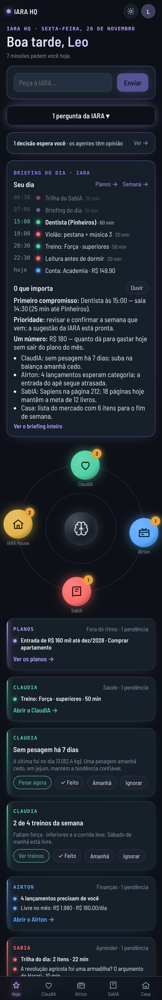

**Resposta da barra da IARA** (UX-15, UX-16): "li até a página 230" vira registro, com Desfazer por 10 minutos.

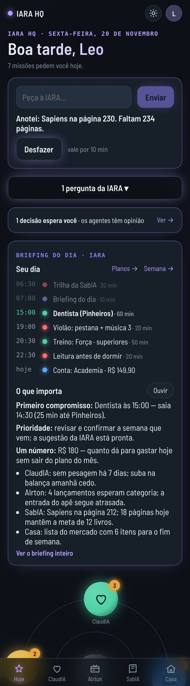

**Aviso aberto em /hoje** (UX-20): a pergunta do aviso com respostas de uma palavra.

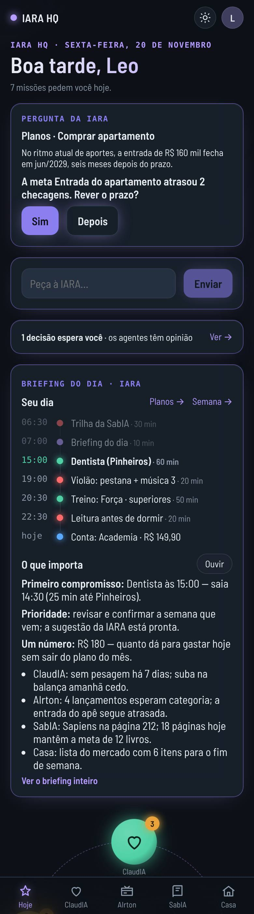

**Planos** (UX-10, UX-13, UX-14): cartão de decisão com posições e confiança, propostas da IARA, Novo plano e os planos por horizonte.

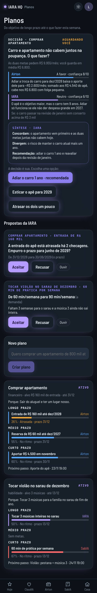

**Novo plano: pergunta da IARA** (UX-11): a etapa em que falta valor ou prazo.

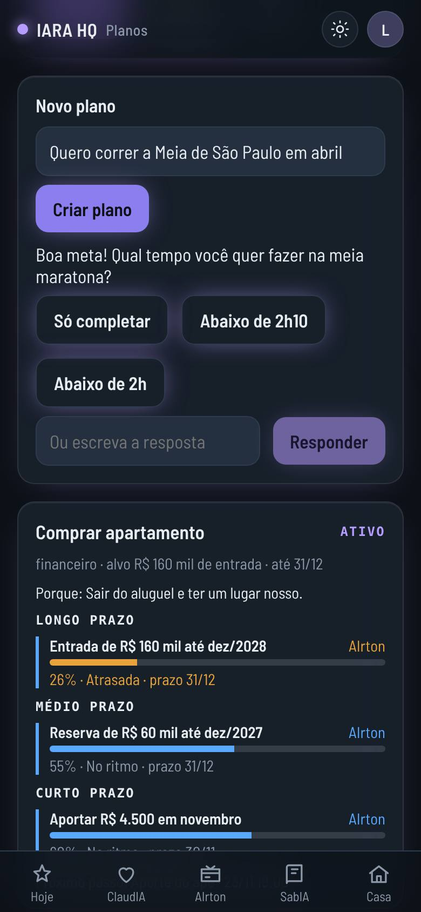

**Novo plano: rascunho** (UX-11): metas por horizonte, primeiro passo, checagem de dinheiro e Sim, confirmar / Descartar.

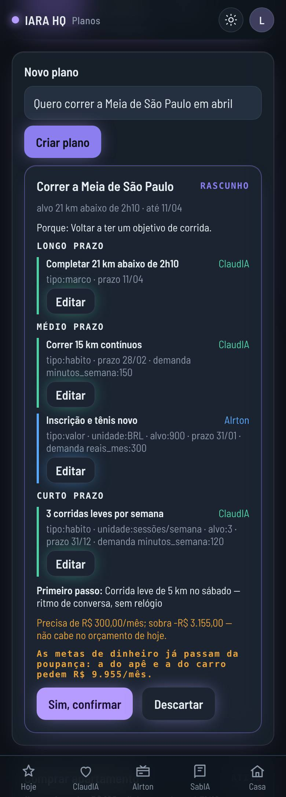

**Finanças** (UX-03, UX-07): Para revisar com Aceitar/Trocar e Metas com o alerta de conflito.

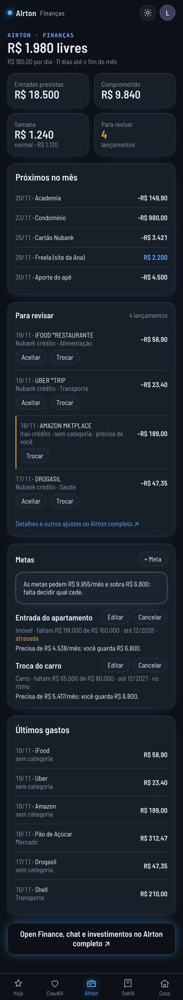

**Aprender: trilha** (SabIA): a trilha do dia.

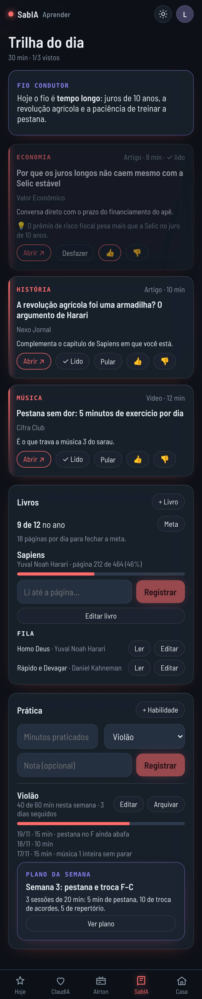

**Aprender: livros e prática** (UX-02, UX-17): meta do ano, páginas/dia, livro atual, fila e prática de violão.

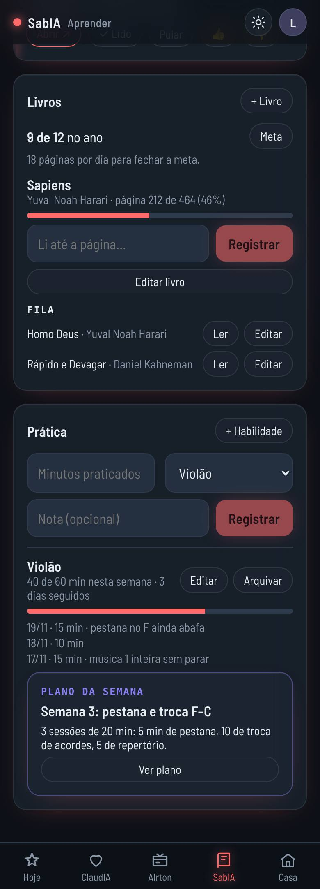

**Semana: topo** (UX-14): expediente, compromissos e lugares.

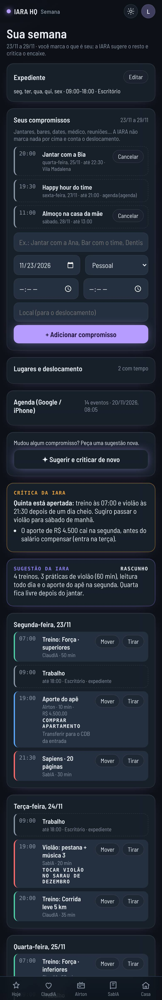

**Semana: plano** (UX-14): crítica da IARA e dias com etiqueta do plano e "ajustado por você".

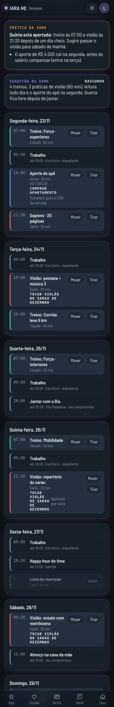

**Semana: Revisar falando** (UX-22): uma decisão por vez.

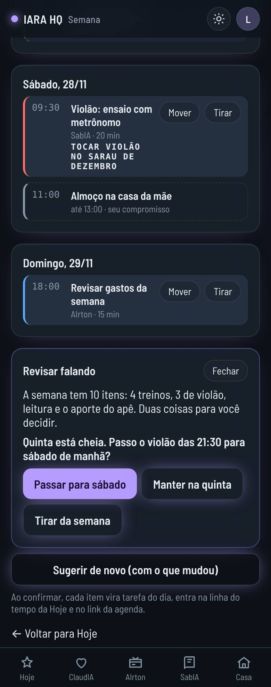

**Semana: confirmar** (UX-16, UX-22): Confirmar a semana, Revisar falando e Sugerir de novo.

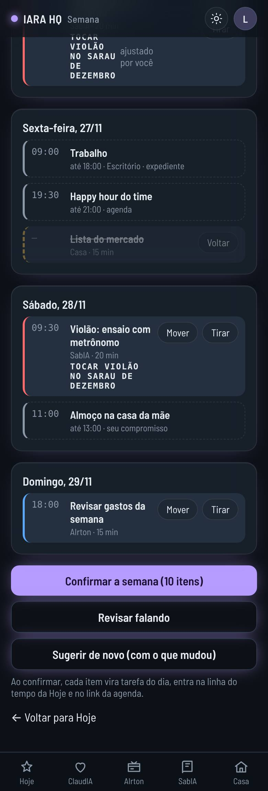

**Saúde** (UX-06): alertas da ClaudIA com Feito/Amanhã/Ignorar.

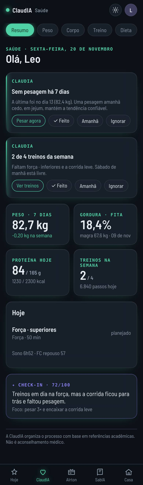

**Perfil** (UX-04, UX-19, UX-20): notificações, Limites, Atalho de peso e Falar com a IARA pela Siri.

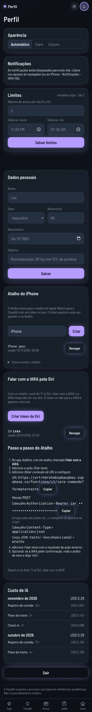

## 10. Onda 4: voz em todo lugar (planejada, ainda não implementada)

A onda 4 leva a IARA para três canais de voz: o microfone dentro do hub, o iPhone e o Apple Watch pela Siri, e o iPad da sala como central sempre ligada. Foi planejada em 23/11 e nada dela está no ar ainda: estes são os testes que valerão quando cada item entrar. A persona continua a IARA. O cérebro é o mesmo `iara-comando`, com as regras de "sim" e Desfazer da sua D3.

**O que depende de você antes:**

| Para | O que fazer | Onde |
| --- | --- | --- |
| UX-26 | Criar conta no Picovoice (grátis), treinar "Ei IARA" em Portuguese para Web (WASM) e me mandar o `.ppn` | `console.picovoice.ai` |
| UX-26 | Cadastrar a AccessKey como `PICOVOICE_ACCESS_KEY` | Supabase → Edge Functions → Secrets |
| UX-21 | Chave comum do Gemini como `IARA_GEMINI_KEY_VOZ` | `aistudio.google.com` → Supabase Secrets |
| UX-21 | Chave da OpenAI com limite de US$ 10 como `IARA_OPENAI_KEY_VOZ` | `platform.openai.com` → Supabase Secrets |
| UX-21 | Confirmar o teto de voz de US$ 15/mês (a D4 dizia US$ 5) | Me dizer |

### UX-23 · Microfone dentro do hub

**O que muda:** botão de microfone na barra da IARA, em todas as telas. Você fala em português, a IARA executa e responde em voz alta, e a tela se atualiza na hora. Ela sabe o que está na tela, então "essa meta" e "o segundo" funcionam. Usa o reconhecimento e a voz do próprio Safari: custo zero.

**Casos de uso:** em `/planos`, "muda o prazo dessa meta para 2028"; em `/aprender`, "li até a 250"; em `/semana`, "passa o segundo item para sexta".

**Como testar:**

1. Toque no microfone e permita o acesso quando o iPhone pedir (**Allow**).
2. Em `/planos`, com uma meta visível, diga "muda o prazo dessa meta para 2028" e depois "sim".
3. Diga "desfaz" após registrar uma leitura por voz.
4. Teste em lugar barulhento e com o iPhone em inglês.

**Esperado:** transcrição em português mesmo com o iPhone em inglês; ação certa no item que estava na tela; tela atualizada sem recarregar; resposta falada de até 2 frases.

**Atenção:** é sempre tocar para falar. No app instalado, o iPhone pode pedir a permissão de microfone de novo. Se o reconhecimento do Safari falhar, o botão some e vale o ditado do teclado.

### UX-24 · Editar 100% dos planos por voz

**O que muda:** um levantamento de toda ação das telas de planos, metas, rascunho do Novo plano e semana. Cada ação sem comando de voz ganha uma intenção no catálogo. Mexer em plano ou meta continua pedindo "sim".

**Frases de teste:**

| Frase | Esperado |
| --- | --- |
| Renomeia o plano do carro para Troca do carro 2027 | Pede "sim" e renomeia |
| Pausa o plano do violão | Pede "sim" e pausa |
| Retoma o plano do violão | Pede "sim" e retoma |
| Arquiva essa meta | Pede "sim" e arquiva |
| Passa essa meta para médio prazo | Pede "sim" e troca o horizonte |
| Essa meta é da SabIA | Pede "sim" e troca o dono |
| Muda o valor da entrada para 180 mil | Pede "sim" e muda o valor |
| Adiciona uma meta de juntar 10 mil até março | Pede "sim" e cria a meta |
| No rascunho, tira a meta de curto prazo | Edita o rascunho do Novo plano |
| Tira o terceiro item da semana | Tira o item, com Desfazer |

**Esperado:** 100% das ações do levantamento executáveis por voz, todas com linha no catálogo.

**Atenção:** se alguma ação que você faz pela tela não funcionar por voz, anote a frase: é item que faltou no levantamento.

### UX-25 · Atalho "IARA" no iPhone e no Apple Watch, com resposta por push

**O que muda:** o Atalho passa a se chamar **IARA** ("Hey Siri, IARA") e funciona no Watch, no botão de ação do iPhone e com o AirPods. Pergunta que demora ou resposta longa vira push: a IARA responde na hora "te mando no push" e o detalhe chega como notificação.

**Casos de uso:** com o AirPods, "quanto posso gastar hoje?"; no Watch, "registra 82 quilos"; "como foi meu mês de gastos?" com a resposta por push.

**Como testar:**

1. No app **Shortcuts**, renomeie o atalho para **IARA** e confira que **Dictate Text** está com **Language** = **Portuguese (Brazil)**.
2. No Watch: "Hey Siri, IARA" → "registra \[seu peso\] quilos".
3. Com o AirPods: "como foi meu mês de gastos?". Ative **Settings → Notifications → Announce Notifications** para ouvir o push.
4. Configure o botão de ação: **Settings → Action Button → Shortcut → IARA**.

**Esperado:** resposta curta falada no fone; resposta longa chega por push em até 1 minuto; nada passa do máximo de avisos por dia.

**Atenção:** com a Siri em inglês, "IARA" pode não ser reconhecido de primeira; se falhar, teste outro nome curto. Não dá para trocar o "Hey Siri" por outra palavra no iPhone e no Watch.

### UX-26 · iPad da sala como central, com "Ei IARA"

**O que muda:** tela nova do hub em modo central (relógio, o dia, planos e a órbita), sempre acesa, escutando só a palavra "Ei IARA" pelo Picovoice, dentro do iPad. Depois de chamar, você conversa sem repetir a palavra. A primeira versão usa a voz do Safari; a voz natural vem com a UX-21.

**Preparação do iPad:** na tomada; **Settings → Display & Brightness → Auto-Lock → Never**; abrir a tela central pelo ícone do hub; travar com **Settings → Accessibility → Guided Access**.

**Casos de uso:** da cozinha, "Ei IARA, o que tenho amanhã?"; "Ei IARA, li até a página 300" e, em seguida, "e quanto falta para a meta do ano?".

**Como testar:**

1. Diga "Ei IARA" 10 vezes a 1 m, 3 m e 5 m do iPad.
2. Deixe a TV ligada por 1 hora sem falar com a IARA.
3. Faça uma conversa de 3 trocas sem repetir a palavra.

**Esperado:** ativa em pelo menos 9 de 10 vezes a 3 m; no máximo 1 disparo falso por hora com a TV ligada; a conversa segue até cerca de 20 s de silêncio.

**Atenção:** um app web não escuta com a tela apagada: o iPad precisa ficar com a tela central aberta. A AccessKey do Picovoice chega ao iPad só depois do seu login e fica só na memória da página. Confira os limites do plano Free do Picovoice.

### UX-21 · Voz natural em tempo real (protótipo)

**O que muda:** conversa contínua com voz natural, em que você pode interromper a IARA no meio da fala. O provedor só ouve e fala; quem decide e executa é a IARA de sempre. Primeiro vem o protótipo de 1 dia comparando Gemini Live (favorito, mais barato) e OpenAI Realtime (plano B).

**Roteiro do protótipo:**

1. As 20 frases da bateria do UX-18 em cada provedor, no iPad.
2. Medir: acerto da ação (alvo 18 de 20), tempo até começar a falar, tempo para parar quando você interrompe (alvo 0,5 s) e custo real por minuto.
3. Você ouve os dois e escolhe.

**Esperado:** tabela comparativa com os números medidos; custo total do protótipo abaixo de US$ 2; nenhuma chave no navegador (só token temporário).

**Atenção:** a sessão fecha sozinha após 20 s de silêncio, então só se paga o tempo de conversa. Acima do teto do mês, a voz natural é recusada e volta a voz do Safari.

### Acompanhamento da onda 4

| Item | Teste principal | Depende de | Status | Observação |
| --- | --- | --- | --- | --- |
| UX-23 | Microfone executa e atualiza a tela | Implementação | Não testado |  |
| UX-24 | As 10 frases de edição (no ar pelo #62) | UX-23 | Não testado |  |
| UX-25 | Watch, AirPods e push da resposta longa | Renomear o Atalho | Não testado |  |
| UX-26 | "Ei IARA" a 3 m e TV sem falso disparo | Picovoice: `.ppn` e AccessKey | Não testado |  |
| UX-21 | Protótipo com os dois provedores | Chaves de voz e teto | Não testado |  |
